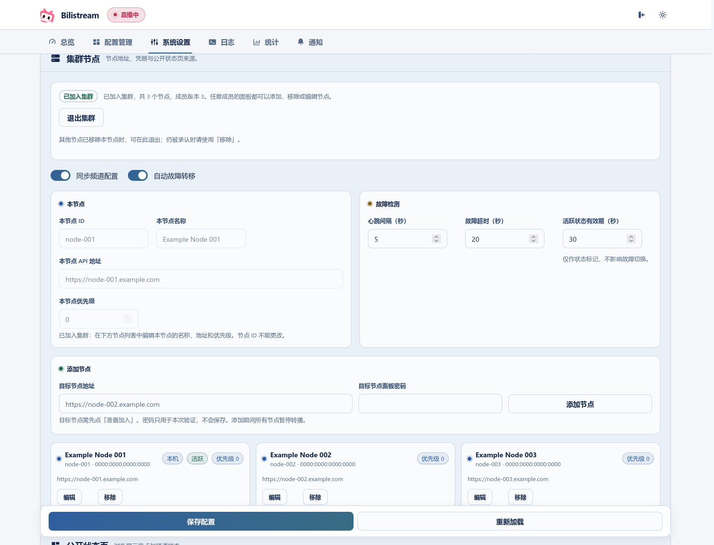
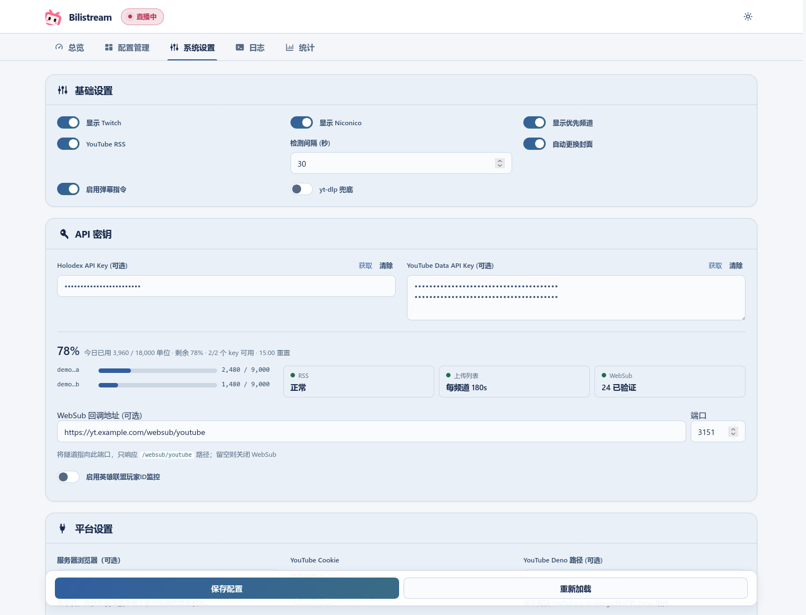

# 高级设置

[返回首页](../README.zh_CN.md) · [English](advanced-settings.md)

普通 YouTube/Twitch 转播按首页配置即可使用，以下功能可根据需要启用。

## 控制面板

YouTube 和 Twitch 卡片支持按平台配置标题、分区、画质、裁剪和 HLS 缓存。转播控制包括 Bilibili 开播/关播、重启转播、码率与缓存仪表、标题/分区/封面更新以及防撞车配置。设置 Holodex API Key 后可以浏览直播与预告、切换转播目标、查看推荐分区；还可以选择登录以使用收藏夹功能。

优先监控和多节点功能默认关闭；显示设置不会改变监控状态。已有配置项保持兼容。

## 命令行选项

以控制台或托盘模式启动，也可设置单个选项：

```bash
./bilistream --webui
./bilistream --tray
./bilistream --port 3150
./bilistream --bind 127.0.0.1
./bilistream --ffmpeg-log-level error
```

Windows 默认使用系统托盘，Linux/macOS 默认使用控制台 Web UI。以上命令使用 `./bilistream`，Windows 请改用 `bilistream.exe`。

| 选项 | 环境变量 | 用途 |
| --- | --- | --- |
| `--bind ADDR` | `BILISTREAM_BIND` | 面板访问地址，默认 `127.0.0.1`。 |
| `-p`、`--port PORT` | `BILISTREAM_PORT` | 面板访问端口，默认 `3150`。 |
| `--password PASSWORD`、`--password-file PATH` | `BILISTREAM_PASSWORD` | 仅首次导入面板密码；已设置或明确清除过的密码不再重复导入。见[远程访问与密码](remote-access.zh_CN.md)。 |
| `--ffmpeg-log-level LEVEL` | `BILISTREAM_FFMPEG_LOG_LEVEL` | `error`、`info` 或 `debug`，默认 `error`。 |
| `--reset-panel-password` | — | 停止服务后离线清除面板密码然后退出，见[忘记密码](remote-access.zh_CN.md#忘记密码)。 |
| `--export-legacy DIR` | — | 导出供旧版使用的明文数据后退出，见[回退旧版](data-and-upgrades.zh_CN.md#回退旧版)。 |
| `-h`、`--help` / `-V`、`--version` | — | 显示帮助或版本后退出。 |
| — | `BILISTREAM_DATA_DIR`、`BILISTREAM_KEY_FILE` | 数据目录与受限密钥位置，见[数据与备份](data-and-upgrades.zh_CN.md)。 |

## 优先频道

**优先频道**：YouTube/Twitch 的可选优先频道卡片。基础设置中的 **显示优先频道** 只控制卡片是否显示；卡片内的监控开关启用优先选择，**自动重启流** 允许在转播其他频道时，等优先频道确认可播放后自动切换。隐藏卡片不会停止监控。

1. 在「系统设置 → 基础设置」中勾选「显示优先频道」并保存。
2. 在仪表盘卡片中选择频道和默认分区，打开监控开关。
3. 需要打断当前转播并切换到优先频道时，再开启「自动重启流」。

显示和监控是两个独立的设置。只隐藏卡片会保留已启用的监控；要停止优先调度，应关闭卡片内的监控开关。

自动选择会按 **优先频道 → Niconico → YouTube → Twitch** 检查可播放且未受限的来源。优先频道的两个平台同时直播时，YouTube 优先。播放优先频道不会改写已保存的 YouTube/Twitch 目标和分区，结束后仍可回到原目标。`%转播%` 弹幕更新指定平台的监听目标，下一次选台仍遵循这一顺序；日志会分别记录命令结果和实际选择的来源。

B 站警告、切断或限时封禁会临时跳过受影响频道，优先频道也适用。修改其他目标或启动 ffmpeg 进程不会解除限制。另一频道确认开始推流、原来源确认下播，或同一来源以新的 YouTube 视频 ID／Twitch 直播 ID 开始新一场时，限制解除；改标题、新增预告、缺少 ID 或查询失败不会解除。

也可通过「重启流」、重启 bilistream、明确指定该频道的弹幕或优先卡片上的解除按钮恢复资格。卡片按钮只解除限制，当前流继续运行；开启「自动重启流」后，可播放的优先频道可能再次抢占。直播间限时封禁仍须等待解封时间。

## YouTube 发现设置

| 设置或来源 | 作用 |
| --- | --- |
| YouTube Data API Key | 确认直播/预告状态，并提供上传列表轮询额度；不同 Google 项目的多个 key 提供各自的额度。 |
| 基础设置 → **YouTube RSS** | 读取频道订阅源，默认开启。关闭后仍会处理 WebSub，并按可用配额轮询上传列表。 |
| WebSub 回调地址与端口 | 接收推送线索，单机可用；需要 YouTube key 和可访问的公网回调地址。地址留空即关闭。 |
| Holodex API Key | 补充元数据、分类、预告和外部直播信息；可选登录以使用收藏夹。 |
| 基础设置 → **yt-dlp 兜底** | 每轮直接探测 YouTube。关闭时，索引模式仍会定期用 yt-dlp 安全探测。 |

RSS 和 WebSub 用于发现视频 ID，本身不能证明直播可播放。Data API 确认状态，实际转播还需要可用的流地址。RSS 关闭或故障时，由上传列表在可用配额内兜底；WebSub 失效时恢复正常轮询速度。详见 [发现与回退](youtube-discovery.md) 和 [WebSub 隧道配置](websub-tunnel.md)。

多节点使用共享索引时，由 **YouTube 索引节点** 负责发现，请在该节点上设置 key、RSS 和回调。它与 **转播活跃节点** 可以是不同的机器，不要把这两个角色混为一谈。

## 统计历史

打开「统计」可查看转播场次、重连、推流质量与观众曲线、集群变化和 QQ 发送尝试。点击场次查看详情，或选择节点缩小集群统计范围。B 站汇总按可用数据展示，缺失值显示为 `--`。

统计设置由各节点独立保存。高级客户端可通过已登录的 `GET /api/config` 读取设置，并通过 `POST /api/config` 提交需要修改的 `history` 字段；面板暂未提供专门的统计设置表单。`enabled` 在重启 bilistream 后生效，采样和保留期设置可在运行中更新。

| `history` 下的设置项 | 默认值 | 用途 |
| --- | --- | --- |
| `enabled` | `true` | 下次进程启动后是否记录新历史；已有历史仍可查询。 |
| `sample_secs` | `10` | 推流质量采样间隔，5–60 秒。 |
| `bili_sample_secs` | `5` | 每种 B 站观众计数的最短采样间隔，5–60 秒。 |
| `bili_stop_summary` | `true` | 直播结束后获取可用的 B 站汇总。 |
| `retention.raw_days` | `7` | 原始样本保留天数，1–90。 |
| `retention.rollup_days` | `90` | 分钟汇总保留天数，1–90，不能短于 `raw_days`。 |
| `retention.event_days` | `180` | 事件保留天数，1–3650。 |
| `retention.event_rows` | `200000` | 事件记录条数上限，100–2000000。 |
| `retention.max_mb` | `512` | 统计存储空间预算，16–65536 MiB。 |

缩短保留期后，维护过程会逐步删除较早的历史。清空统计或换机前，请参阅[数据与备份](data-and-upgrades.zh_CN.md#统计历史)。

## 公开状态页

单台电脑或服务器即可使用。在「系统设置 → 公开状态页」中选择**本机**并保存，多节点保持关闭。默认访问 `http://127.0.0.1:23234`。[单机配置与分享方式](public-status.md)。

## 多节点

**可选多节点**：提供活跃/备用节点管理、健康检查、配置同步和自动转移功能。公开状态页由指定节点通过独立端口提供。

- 默认关闭；单个节点不需要任何集群设置。
- 转播活跃节点负责推流，备用节点等待交接；自动转移依赖心跳、多数节点确认和来源停止检查，无法确认安全接管时保持限制。
- 指定公开状态页节点、独立端口和公网 URL。状态页不提供管理功能。
- 公开状态页节点有可用 YouTube key 时，它同时也是 YouTube 索引节点；可以与转播活跃节点不同。
- key、RSS、WebSub 回调和卡片显示设置属于各节点本地配置。共享索引模式下，请在索引节点上配置发现来源。

详见 [发现回退](youtube-discovery.md) 和 [WebSub 隧道](websub-tunnel.md)。

### 准备工作

- 在每个节点的「系统设置 → 安全」中设置面板密码；无桌面界面的节点可按[远程访问说明](remote-access.zh_CN.md)首次导入。添加节点时会验证该节点的面板密码，未设置密码时不能新建或加入集群。各节点的密码可以不同。
- 每个节点需要一个其他节点可以访问的管理地址：证书有效的 HTTPS（例如通过反向代理或隧道服务），或者在自行建立的认证隧道上使用本机回环地址，例如 `http://127.0.0.1:8443`。普通局域网/VPN 的 HTTP、自签名证书和重定向都会被拒绝。

### 新建集群并添加节点

1. 在第一个节点上打开「系统设置 → 集群节点」，填写「本节点」（ID、名称、地址、优先级），点击「新建集群」。它将成为唯一的成员。
2. 在每台要加入的节点上填写「本节点」，点击「准备加入」。这会停止它的转播，直到添加完成。在添加完成或被取消前，它一直保持暂停状态；预约不会自行过期。
3. 在集群中任意一个节点的「添加节点」中，填写新节点的地址和面板密码。密码只发送给该节点一次，不会保存。

每个成员的面板都有相同的操作：添加、移除节点，编辑节点的名称、地址或优先级，以及更改公开状态页节点（「更改运行位置」）。没有专门的管理节点。节点 ID 和身份不能修改；需要更换时请先移除再重新添加。这些操作立即生效，不影响页面上尚未保存的其他设置。



### 维护规则

- 每次变更都会暂停所有节点的转播，直到操作完成。所有保留在集群中的节点必须在线，并需要原成员中的多数确认。例如三台中有两台在线时，可以移除离线的备用节点；两台集群中被隔离的一台不能移除另一台。
- 移除活跃节点时，会先停止它的转播并确认已停止。移除公开状态页节点时，需要选择接替的节点，或关闭状态页。被移除的节点即使处于离线状态，也会在所有保留的节点上失去权限；能连接时，它会关闭全部监控，并且不会自行恢复转播。
- 当其他节点已经移除某个节点后，该节点虽然仍显示「已加入集群」，但可以点击「退出集群」。确认后，它会逐一询问成员列表中的每一台其他节点：这个身份是否还在集群中。只有每台都返回签名确认该身份已不在时，才会关闭全部监控并退出。频道、凭据和面板密码都会保留。如果有节点仍承认本节点，则不做任何更改，请改用「移除」。如果有节点没有应答，或者应答没有通过时钟、签名或版本检查，又不是明确确认，则也不做任何更改，面板会显示出该节点的名称。网络不通不算已被移除。成员变更进行中时，此按钮不可用。退出之后，在本机点击「准备加入」，再由仍在集群中的节点「添加节点」。可以使用原来的节点 ID；重新加入会生成新的身份。
- 面板会显示当前步骤和仍需响应的节点。页面刷新或响应丢失时，会继续同一项变更；请使用「重试」，不要重新发起。上一项变更送达所有节点后，才能开始下一项变更。
- 发起变更的节点负责协调。当它离线时，变更保持待处理状态，其他节点保持暂停，直到它恢复。不要为了绕过待处理变更而移除它或重建集群。

## Niconico Live

配置 Niconico 频道及 streamlink，在系统设置中直接填写 `user_session` 的值。无需导出整份 Cookie；旧版 Netscape 文件路径仍然兼容。每日检测只验证登录是否可用，不会延长有效期；网络异常与明确失效会分开显示。[可用性检测说明](niconico-session.md)。

基础设置中的「显示 Twitch」「显示 Niconico」「显示优先频道」只控制卡片显示，隐藏不会停止监控。未加入集群时，仪表盘会隐藏多节点卡片。Niconico 使用管道输入；优先频道目前支持 YouTube/Twitch。

## 弹幕、分区规则与英雄联盟检查

弹幕切换使用频道管理中保存的频道名称，例如：

```text
%转播%YT%示例频道1%英雄联盟
%转播%TW%示例频道1%无畏契约
%查询
```

分区关键词规则可能会调整请求的分区。英雄联盟玩家名称检查需要 Riot key，`lol_monitor_interval` 的单位是分钟。玩家名称过滤关键词位于 Riot API Key 下方，仅在启用英雄联盟玩家 ID 监控时显示。

## 设置预览



截图来自真实界面，使用模拟数据。
