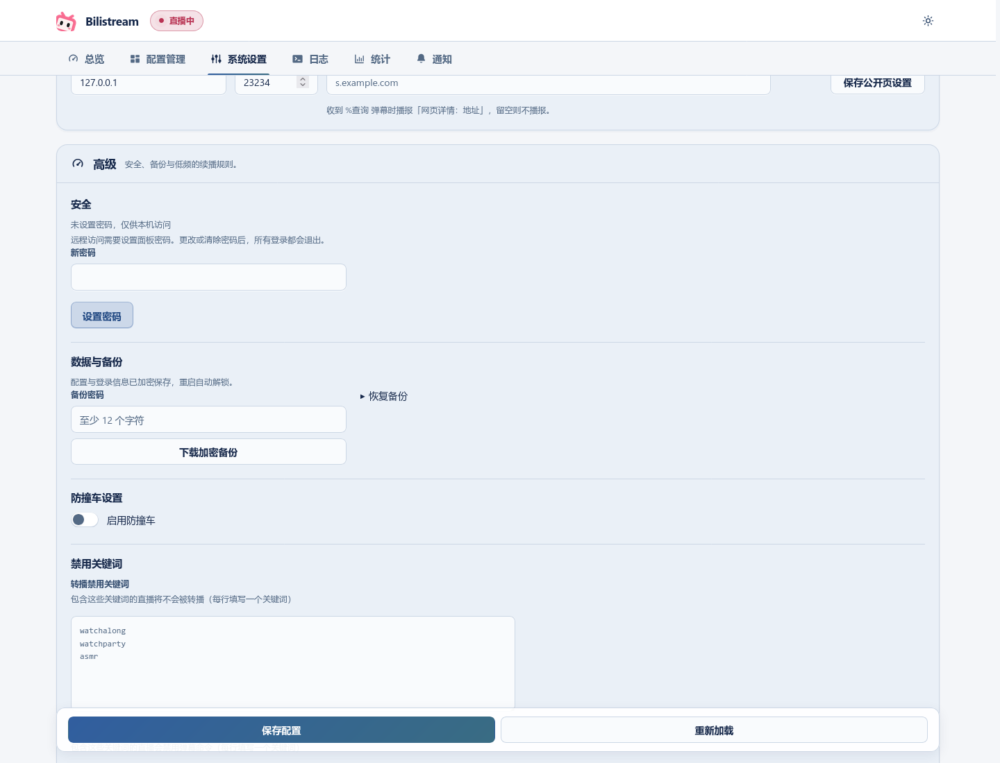

# 数据、备份与升级

[返回快速开始](../README.zh_CN.md) · [English](data-and-upgrades.md)

## 数据位置

设置、频道、规则和发现统计保存在程序旁的 `data/bilistream.db` 中。配置与登录信息加密保存，在本机重启时自动解锁；日常修改通过 Web UI 完成。可用 `BILISTREAM_DATA_DIR` 指定数据目录，用 `BILISTREAM_KEY_FILE` 指定目录**之外**的受限密钥文件。

请保留原密钥，单独复制数据库不能用于换机恢复。不要删除数据库的 `-wal`、`-shm` 文件。图片继续保存在缓存目录，`webui/` 是页面资源。

## 统计历史

「统计」页读取同一数据目录中的 `history.sqlite`。每台服务器记录自己的转播场次、重连、推流质量、B 站观众人数和通知发送尝试。集群中的「全部节点」会在查看时合并可用服务器的数据；无法访问的服务器会列在数据缺失提示中。日期和时间按浏览器所在时区显示。

统计历史与设置分开保存，不包含在下载的备份和旧版导出中。换机时若要保留历史，请先停止 bilistream，再一起复制历史数据库及其对应的 `-wal`、`-shm` 文件。若要清空历史，请停止 bilistream 后删除这些历史文件；下次启动时会新建历史数据库。保留 `bilistream.db` 及其相关文件。

默认保留 7 天原始样本、90 天分钟汇总和最多 180 天的事件。B 站汇总取决于直播间登录状态和上游数据，`--` 表示该项数据不可用；汇总缺失不会延迟结束转播场次。保留期和记录开关见[统计设置](advanced-settings.zh_CN.md#统计历史)。

## 备份与恢复

在「系统设置 → 数据与备份」中下载受密码保护的备份，并另行妥善保管备份密码。新安装可以在设置向导中点击「已有备份？直接恢复」。备份不包含面板密码和网页登录会话。恢复会保留目标安装的密码选择；全新安装需要在本机设置面板密码，或在首次启动时提供初始密码。

备份从不包含集群身份。从集群成员导出的备份恢复后不属于任何集群，监控全部关闭；之后请重新新建或加入集群。已在集群中或正在准备加入的服务器无法恢复备份。



## 升级

切换新版前先停止旧进程。升级时会自动导入原有 JSON 和 Cookie 文件；缺少新设置项的旧配置也可以直接升级，新增设置使用默认值。确认加密恢复副本无误后，才会移除程序目录内的旧数据；外部 Cookie 文件不会被删除。

多服务器各自保存数据库和密钥。新旧版本不能同时运行：升级前停止所有服务器，为每台服务器做一份物理备份（包括停止后的数据目录、密钥文件、程序和启动命令）。之后全部升级，并在「系统设置 → 多服务器节点」中重新建立集群。

## 回退旧版

先停止服务，再用**新版**程序运行：

```bash
./bilistream --export-legacy ./downgrade-data
```

新目录内是供旧版使用的明文配置和凭据，使用完后请删除。

旧版无法读取 Web UI 保存的面板密码。回退前请停止服务；启动旧版远程监听时，必须明确提供 `--password-file` 或 `BILISTREAM_PASSWORD`，也可以先以本机地址启动。仅回退程序文件不能保留新版的密码保护。明文导出也不包含面板密码；请保留原数据库与密钥，以便日后返回新版。

服务器新建、准备加入或加入集群后，或者保存着已暂停的旧集群配置时，旧版会拒绝打开它的数据库。此类服务器的明文导出不属于任何集群，监控全部关闭。回退集群时，先停止所有服务器，再一起恢复各自在升级前做的物理备份。不要让新旧版本在同一集群中运行，也不要只替换部分服务器的程序。
